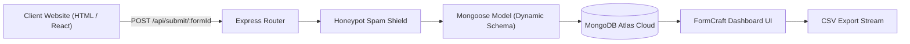

# FormCraft ⚡
> **Headless Form Backend & Submission Analytics Platform**  
> *Built with Node.js, Express, MongoDB Atlas, Mongoose, and Vanilla JavaScript.*

FormCraft is a self-hosted form backend service (similar to Formspree). It allows frontend developers, freelancers, and businesses to embed contact forms, feedback widgets, and intake forms into any website with **zero custom backend code**.

---

## 🎯 The Real-World Problem It Solves

Static websites (HTML/CSS, React, Astro, Next.js static exports) cannot receive form submissions or send emails without a running backend server and database. Building a dedicated server, configuring databases, preventing spam bots, and formatting data for every simple contact form is costly and time-consuming.

**FormCraft solves this:** Developers create a form endpoint in the dashboard, paste the generated URL into their HTML `<form action="..." method="POST">`, and FormCraft handles validation, bot neutralization, storage, and CSV analytics.

---

## 🏗️ Architecture & Data Flow



---

## 🚀 Key Engineering & Architecture Highlights

1. **Dynamic Schemas via MongoDB `Schema.Types.Mixed`**
   * *Why MongoDB over SQL:* Different forms require completely different fields (e.g. Contact Form has `name`, `email`; Job Application has `portfolio`, `expectedSalary`, `experience`). MongoDB's flexible BSON document model accepts and stores arbitrary user fields without table migration friction.
2. **Invisible Honeypot Spam Protection**
   * Neutralizes automated web-crawling spam bots using hidden trap fields (`_gotcha`) without annoying human visitors with slow CAPTCHAs.
3. **Database Performance & Relational Integrity**
   * Indexed foreign key lookups (`formId: { type: ObjectId, ref: 'Form', index: true }`).
   * Explicit **Cascade Deletions** (`Submission.deleteMany({ formId })`) to prevent orphan records when forms are deleted.
4. **HTTP Header-Controlled File Streaming**
   * Converts dynamic JSON records into spreadsheet columns on-the-fly and triggers browser downloads via `Content-Type: text/csv` and `Content-Disposition: attachment`.
5. **Zero-Dependency Vanilla JS Dashboard**
   * Fast, responsive dashboard built with pure Vanilla JavaScript (DOM manipulation, `fetch()` async/await, modal lifecycle, and XSS sanitization).

---

## 📡 REST API Reference

| Method | Endpoint | Description |
| :--- | :--- | :--- |
| `POST` | `/api/forms` | Create a new form endpoint |
| `GET` | `/api/forms` | List all registered forms |
| `POST` | `/api/submit/:formId` | Public endpoint receiving submissions from any website |
| `GET` | `/api/forms/:formId/submissions` | Retrieve all received submissions for a specific form |
| `GET` | `/api/forms/:formId/export` | Stream and download submissions as a CSV spreadsheet |
| `DELETE` | `/api/forms/:formId` | Cascade delete a form and all associated submissions |
| `GET` | `/api/health` | Service health status check |

---

## 💻 Tech Stack

* **Runtime:** Node.js (v22+) — Modern ES Modules (`import/export`)
* **Framework:** Express.js (v5+)
* **Database:** MongoDB Atlas (Cloud)
* **ODM:** Mongoose (v9+)
* **Frontend:** Vanilla JavaScript (ES6+), HTML5, Tailwind CSS
* **Security & Utilities:** CORS, Dotenv, Honeypot Bot Filtering

---

## ⚙️ Quickstart & Local Setup

### 1. Clone the repository
```bash
git clone https://github.com/yourusername/formcraft.git
cd formcraft
```

### 2. Install dependencies
```bash
npm install
```

### 3. Configure environment variables
Create a `.env` file in the root directory:
```env
PORT=5000
NODE_ENV=development
MONGODB_URI=your_mongodb_connection_string
JWT_SECRET=your_jwt_secret_key
FRONTEND_URL=http://localhost:5000
```

### 4. Start the development server
```bash
npm run dev
```

Open your browser and navigate to:
```
http://localhost:5000
```

---

## 📄 License
ISC License
